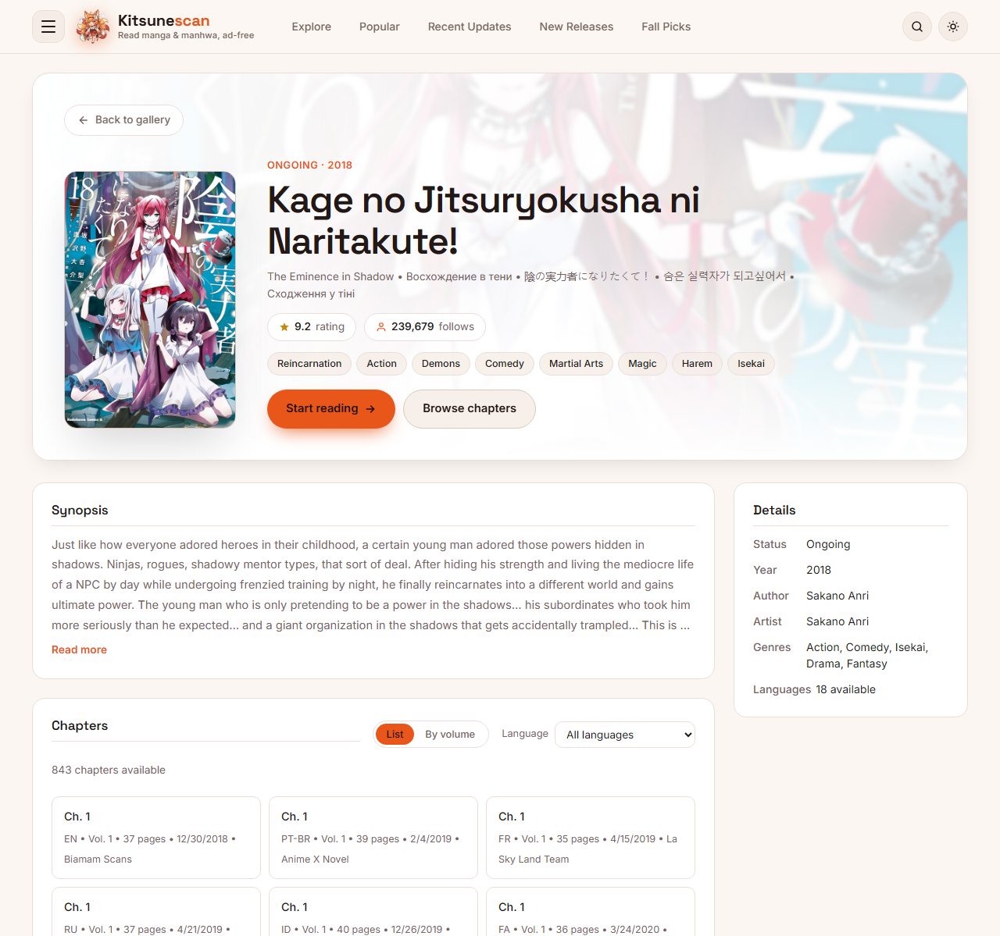
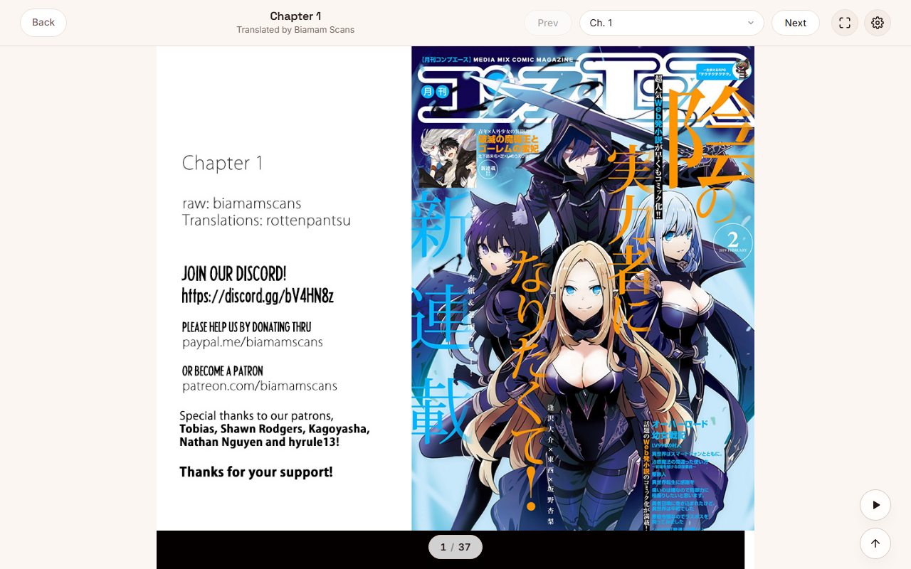
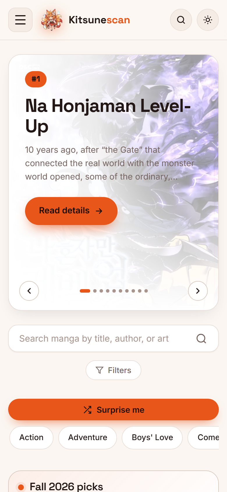
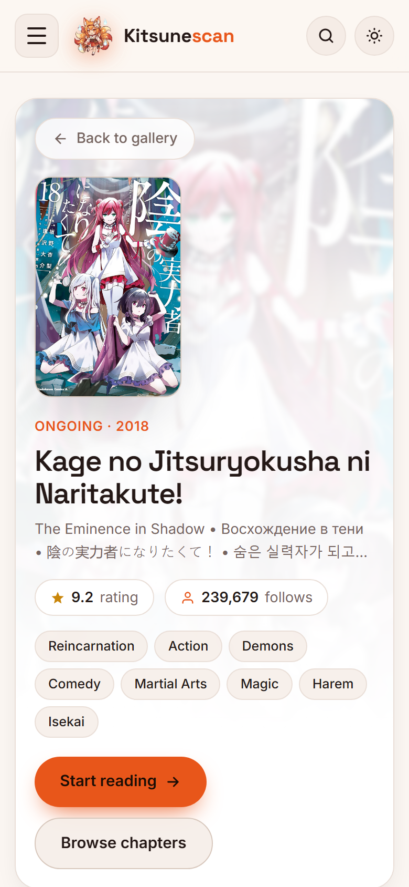
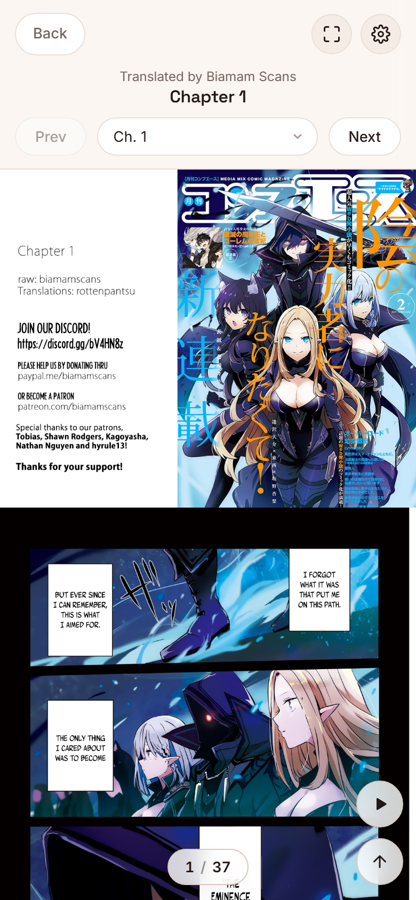

# Kitsunescan

A fast, minimalist manga reader built on the [MangaDex API](https://api.mangadex.org/docs/).
React (Vite) front end + a small Express server that proxies MangaDex, rate-limits itself,
and streams images so the browser only ever talks to your own domain.

## Screenshots

| Explore | Details | Reader |
|---|---|---|
|  |  |  |

**Mobile**

| Explore | Details | Reader |
|---|---|---|
|  |  |  |

> To refresh these with live MangaDex data (real covers and pages), run once:
>
> ```bash
> npm run install:all
> npx playwright install chromium
> npm run screenshots      # starts the real server, calls the live API, overwrites docs/screenshots/*
> ```

## Features

- Explore, Popular, Recent updates and New releases tabs with search, suggestions and filters
- Manga details with chapter list, volume/chapter tree, ratings and follows
- Page-by-page chapter reader with reader settings and "resume where you left off"
- Dark / light theme, responsive layout with burger navigation
- Real routes (`/manga/:id`, `/manga/:id/chapter/:chapterId`), so refresh and deep links work
- Scanlation group credit on every chapter, plus a removal-request block list
- Built to follow MangaDex's usage policy (see [MANGADEX-API-AUDIT.md](MANGADEX-API-AUDIT.md))

## Tech stack

| Layer | Tools |
|---|---|
| Client | React 18, React Router 6, Vite 5 |
| Server | Node 18+, Express 4, undici, compression, express-rate-limit |
| Hosting | Vercel (static client + serverless API) or any Node host |

## Project layout

```
.
├── api/index.js          # Vercel serverless entry (re-exports server/app.js)
├── client/               # React app (Vite, multi-page build)
│   ├── src/              # components, reader, pages, api.js, styles.css
│   ├── screens/          # standalone HTML UI screens
│   └── public/           # favicon, logo
├── server/
│   ├── app.js            # Express app: MangaDex proxy, caching, rate limiting
│   └── index.js          # starts the app on PORT (default 3001)
├── docs/screenshots/     # images used in this README
├── scripts/screenshots.mjs  # regenerates screenshots from the live app
├── vercel.json           # build + rewrites for Vercel
├── DEPLOY.md             # GitHub + Vercel deployment guide
└── MANGADEX-API-AUDIT.md # API compliance notes
```

## Quick start

Requires **Node 18+**.

```bash
git clone https://github.com/<your-username>/<your-repo>.git
cd <your-repo>

npm run install:all   # installs root, server and client
npm run dev           # Express on :3001, Vite on :5173
```

Open <http://localhost:5173>. Vite proxies `/api/*` to Express.

Production mode (builds the client, then Express serves everything):

```bash
npm start             # http://localhost:3001  (set PORT=xxxx to change)
```

## Environment variables

None are required. All are optional:

| Variable | Purpose |
|---|---|
| `MANGADEX_CONTACT` | URL or email placed in the `User-Agent` sent to MangaDex (they require an honest, non-spoofed UA). Set it to your repo URL. |
| `MANGADEX_BLOCKED_GROUPS` | Comma-separated scanlation-group UUIDs. Their chapters are hidden from lists and return HTTP 451 when opened. |
| `MANGADEX_REPORT` | Set to `false` to disable MangaDex@Home image reports. Leave unset unless debugging. |
| `UPSTREAM_PROXY_URL` | Static-IP egress proxy (must be transparent, no `Via` header). `HTTPS_PROXY` also works. |
| `PORT` | Port for `npm start` (default `3001`). |

## API routes

Everything lives under `/api` and mirrors the MangaDex endpoint of the same shape.

| Route | Notes |
|---|---|
| `GET /api/manga` | List / search (query forwarded as-is) |
| `GET /api/manga/random` | Random title |
| `GET /api/manga/:id` | Manga details |
| `GET /api/manga/:id/feed` | Chapter feed (blocked groups filtered) |
| `GET /api/manga/:id/aggregate` | Volume / chapter tree |
| `GET /api/chapter`, `/api/chapter/:id` | Chapter list / single chapter |
| `GET /api/at-home/server/:id` | Chapter page image URLs |
| `GET /api/author`, `/api/author/:id` | Authors |
| `GET /api/group`, `/api/group/:id` | Scanlation groups |
| `GET /api/cover`, `/api/cover/:id` | Covers |
| `GET /api/tag` | Genre / theme / format tags |
| `GET /api/statistics/manga`, `/api/statistics/manga/:id` | Ratings and follows |
| `GET /api/image?url=` | Streams a cover or page image (MangaDex hosts only) |
| `GET /api/health` | Cache, proxy and upstream rate-limit status |

## Deploy

Step-by-step GitHub + Vercel instructions are in **[DEPLOY.md](DEPLOY.md)**.

## Credits and disclaimer

- All manga data and images come from [MangaDex](https://mangadex.org). Kitsunescan is an
  unofficial client and is not affiliated with MangaDex.
- Please respect scanlation groups and creators; use `MANGADEX_BLOCKED_GROUPS` to honour removal requests.
